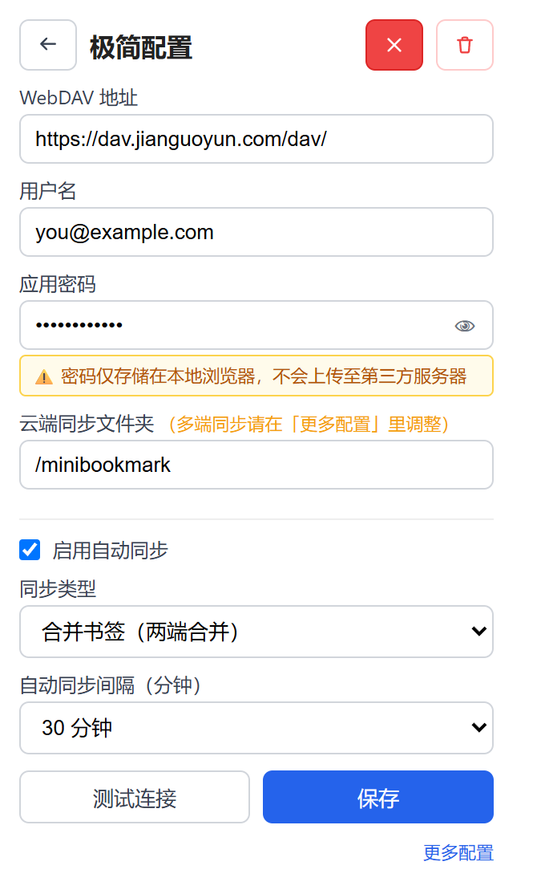
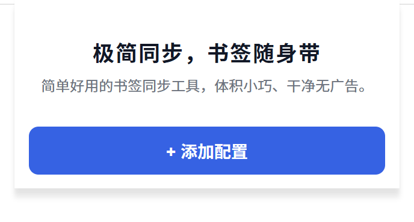

# 极简书签同步（维护版）

> 轻量、干净、无广告的书签同步工具，通过 WebDAV 协议将书签同步到你的私有云盘。
> 本仓库是 [原项目](https://github.com/jagshen/Mini-bookmark-sync) 的维护版：保留原项目的全部功能，
> 并补上手机端支持、双向增量增删，以及一批跨端同步的一致性修复。

[](https://github.com/xiaopeng66/Mini-bookmark-sync/releases)
[](LICENSE)

---

## v2.3.6 发布说明

停止在手机端自动「删除后重建」书签，移动失败时明确报错并原样保留。

- 手机宿主无法直接移动书签时，不再自动新建一份再删除原书签；这一做法在部分手机浏览器上会让书签消失。
- 现在会重发一次移动并复核，仍不落地就明确报错，本机与云端的书签都保持原样。
- 之前版本因此少掉的书签，云端仍保留，下一次合并会自动导回本机。

933 条 JavaScript 回归与 6 条打包工具测试通过。验证使用隔离模拟数据，没有完成真实手机、浏览器 GUI 或生产 WebDAV 验收。安装仍由宿主浏览器确认。详见 [完整发布说明](docs/release-v2.3.6.md)。

## v2.3.5 发布说明

修复手机端移动书签失败时可能把书签删掉的问题，并减少重复提示。

- 手机端宿主不支持直接移动时会先新建并确认，确认后才删原书签；确认不了就保留原书签并中止，不会再删掉书签。
- 写回云端前再次核对位置，有一条不对就停止写回，云端保留原样。
- 失败时不再留下「未完成的本地事务」，可以直接重试。
- 「本服务未提供可用的并发校验」同一级别只提示一次，不再每次同步重复。

933 条 JavaScript 回归与 6 条打包工具测试通过。验证使用隔离模拟数据，没有完成真实手机、浏览器 GUI 或生产 WebDAV 验收。安装仍由宿主浏览器确认。详见 [完整发布说明](docs/release-v2.3.5.md)。

## v2.3.4 发布说明

修复移动书签后手机端同步失败、云端被旧位置覆盖的问题。

- 手机端同步时若没能真正把书签移到云端的新位置（部分浏览器会返回成功但实际不动），现在会复核并重建落地，不再把旧位置写回云端。
- 重建仍失败时明确报错并停止写回云端，云端保留新位置；文件夹移动无法重建时同样中止，不会偷偷删除内容。

931 条 JavaScript 回归与 6 条打包工具测试通过。验证使用隔离模拟数据，没有完成真实手机、浏览器 GUI 或生产 WebDAV 验收。安装仍由宿主浏览器确认。详见 [完整发布说明](docs/release-v2.3.4.md)。

## v2.3.3 发布说明

修复移动书签后另一台设备收不到、云端反被旧位置覆盖的问题。

- 一台设备把书签或文件夹移到别处并同步后，另一台设备同步时能拿到新位置，不再把旧位置写回云端。
- 移动方向以「上次同步时这个书签在哪里」为准，本机残留的旧移动记录不会再反向覆盖云端。
- 剪切/粘贴式移动、网址只差末尾斜杠、移动同时改标题，也都能识别为同一次移动。

929 条 JavaScript 回归与 6 条打包工具测试通过。验证使用隔离模拟数据，没有完成真实手机、浏览器 GUI 或生产 WebDAV 验收。安装仍由宿主浏览器确认。详见 [完整发布说明](docs/release-v2.3.3.md)。

## v2.3.2 发布说明

修复跨文件夹移动书签/文件夹后位置被还原的问题，并让浏览器启动后自动同步一次。

- 把书签或文件夹拖到另一个文件夹，同步后另一端能拿到新位置，不再被还原到原处；源文件夹里只有这一项时同样能传播。
- 同步进行中拖动书签也会被记录，不再因为「正在同步」而丢失这次移动。
- 浏览器打开后，只要自动同步已开启且 WebDAV 配置完整，会额外同步一次，不必等定时间隔到点；与「错过补跑」不会重复执行。

923 条 JavaScript 回归通过。验证使用隔离模拟数据，没有完成真实手机、浏览器 GUI 或生产 WebDAV 验收。安装仍由宿主浏览器确认。详见 [完整发布说明](docs/release-v2.3.2.md)。

## v2.3.1 发布说明

修复「上次本地事务尚未完成」把同步拦住、却无处恢复的问题，并清理操作记录里的误报。

- 设置页新增「本地书签恢复」：查看未完成的事务备份、导出当前书签与备份、确认后再恢复；弹窗与设置页在同步被拦时给出这个入口。
- 检查后确认无需补回任何书签时按成功处理，不再显示失败；确认恢复后即可继续同步。
- 书签已经同步完成、只有完成状态没保存上的情况只补记状态，不用旧备份覆盖当前书签，也不撤销之后的新增和删除。
- 「云端未提供强 ETag」的能力提示不再显示成「操作失败」；真正的同步失败与云端冲突仍会显示。

910 条 JavaScript 回归与 6 条打包工具测试通过。验证使用隔离模拟数据，没有完成真实手机、浏览器 GUI 或生产 WebDAV 验收。安装仍由宿主浏览器确认。详见 [完整发布说明](docs/release-v2.3.1.md)。

## v2.3.0 发布说明

本版重点提升恢复安全、跨端一致性和大树处理性能。

- 保护尚未恢复完成的事务备份；重建同步桶后可继续恢复，不接管无关同名目录。
- 保存失败的历史删除基线可跨后台重启补交；目标切换使用各自的云端历史状态。
- 修复 Berry / Via / Aira 的改名层级、删除后重新添加、旧斜杠路径快照迁移，以及 Aira 悬空父引用。
- 网络请求和正文读取有明确期限；只重试明确可重试的失败，提交结果未知时不盲目重跑。
- 主文件已提交后的记账失败明确报告部分完成；桥接基线只随已确认的写入更新。
- 修复改名、移动、换序、嵌套清空和事务回滚中的一致性问题；恢复与同步串行执行，并减少大树合并中的重复扫描。

845 条 JavaScript 回归与 6 条打包工具测试通过。验证使用隔离模拟数据，没有完成真实手机、浏览器 GUI 或生产 WebDAV 验收。安装仍由宿主浏览器确认。详见 [完整发布说明](docs/release-v2.3.0.md)。

## v2.2.2 发布说明

- 修复同一文件夹内只调整书签或文件夹顺序时无法正确同步的问题，包含存在主页内容时的顶层换序。
- 修复两端节点编号冲突导致子树遗漏、重复或顺序异常的问题。
- 新增设置页「版本更新」：检查最新版并下载对应安装包，完善超时、版本识别和失败提示。

安装仍由宿主浏览器确认；能否安装取决于其支持与签名要求。详见 [v2.2.2 发布说明](docs/release-v2.2.2.md)。

## v2.2.1 发布说明

修掉 v2.2.0 的兼容性回归：v2.2.0 要求云端文件必须返回**强 ETag**，否则拒绝写入，导致坚果云等
不返回强 ETag 的服务上「合并」直接失败（显示「云端缺少强 ETag，无法安全地合并写入」）。
v2.2.1 改为按服务器实际能力分层选择并发校验，详见 [v2.2.1 发布说明](docs/release-v2.2.1.md)。
若你装的是 v2.2.0 且同步报该错误，升级到 v2.2.1 即可，不需要改任何配置。

v2.2.0 的内容仍有效：针对 v2.1.0 审查中的数据完整性、目标隔离和跨端失败报告进行修复；
兼容性限制及升级注意事项见 [v2.2.0 发布说明](docs/release-v2.2.0.md)。

## ✨ 功能特色

- 🔄 **多模式同步** — 支持上传、下载、合并三种同步策略
- ⏰ **自动定时同步** — 可设置 5~1440 分钟自动同步间隔
- ☁️ **WebDAV 协议** — 兼容坚果云、Nextcloud、群晖等主流网盘
- 🔒 **数据安全** — 书签数据直连你的云盘，不经过第三方服务器
- 🛡️ **本地备份** — 破坏性导入前校验备份写入；同步失败恢复仅作用于所选同步文件夹
- 🧹 **无广告无追踪** — 干净纯粹，没有任何多余功能
- 💾 **书签备份管理** — 支持创建、浏览、导入历史备份
- 📱 **隐私保护** — 完整的[隐私政策](https://jagshen.github.io/Mini-bookmark-sync/privacy.html)

## 🆕 本版新增（相比原项目）

- 📱 **手机端也能用** — 另外提供 Gecko 引擎浏览器（可拓 / 雨见等）的 MV2 安装包，手机与电脑可以互相同步
- ⏰ **自动同步真能用** — 「重启就丢定时器」的手机浏览器上，每次启动自动重建定时器、并把错过的一轮补跑掉，不再默默不工作
- ⚡ **手机不卡** — 顺序没变化时不再逐个重排书签（245 条书签实测每轮 288 次写入 → 0 次）
- 🔁 **双向增量增删** — 任一端删掉的书签，其他端下次同步跟着删；上传、下载、合并三条路径都生效
- 📂 **单同步桶** — 只同步一个文件夹（自动识别，设置页可改）；失败回滚不清空其他收藏夹
- 📍 **下载写入位置可选** — 像 floccus 一样，在设置里整树任选一个文件夹接收云端内容
- 🧹 **「下载重建」更安全** — 清空只作用于同步文件夹，不再动同步文件夹之外的书签
- 💾 **配置导出 / 导入** — 换浏览器时导出配置文件再导入，不必重填 WebDAV
- ✅ **同步结果更诚实** — 书签写入或手机桥接失败时报告失败/部分完成，不把主文件成功当作全部成功
- 🩺 **后台诊断** — 设置页一键输出诊断报告并一键复制，连「这轮动了几个书签」都看得见
- ⬆️ **检查更新** — 设置页检查最新版并下载当前扩展变体的安装包；安装由宿主浏览器确认，取决于其支持与签名要求

## 📸 界面预览

<table>
  <tr>
    <td align="center">
      <br/>
      <b>配置页面</b>
    </td>
    <td align="center">
      <br/>
      <b>主页</b>
    </td>
    <td align="center">
      <br/>
      <b>新增页面</b>
    </td>
  </tr>
</table>

## 🚀 快速开始

### 1. 安装扩展

到 [Releases](https://github.com/xiaopeng66/Mini-bookmark-sync/releases) 页下载对应安装包
（商店里在架的仍是原项目的旧版本，不含本版修复，建议用下面的旁加载包）：

| 你在用什么 | 装哪个 |
|---|---|
| 桌面 Edge / Chrome | `chromium-sideload.zip` — 解压后在 `edge://extensions`（Chrome 是 `chrome://extensions`）打开「开发人员模式」，点「加载已解压的扩展程序」选该文件夹 |
| 手机 可拓 / 雨见等 | `gecko-mv2-persistent.xpi` — 地址栏显示 `moz-extension://` 的就是 Gecko 引擎浏览器 |
| 手机 Firefox | `gecko-mv2.xpi` — 构建产物未签名；能否安装取决于宿主的签名与安装信任要求，普通 Firefox 不应视为可直接安装 |

### 2. 配置 WebDAV

1. 点击扩展图标打开弹窗
2. 进入设置页面
3. 填写 WebDAV 服务器信息：

| 配置项 | 说明 | 示例 |
|--------|------|------|
| 服务器地址 | WebDAV 服务地址 | `https://dav.jianguoyun.com/dav/` |
| 用户名 | 网盘账号或应用专用密码用户名 | `your@email.com` |
| 密码 | 应用专用密码（非登录密码） | `xxxxxxxxxxxx` |
| 书签路径 | 云端存储文件夹；文件名由扩展配置决定 | `/书签同步` |

### 3. 开始同步

配置完成后，点击「合并」即可完成首次同步。

- **首次同步建议用「合并」**：两端内容会合到一起，不会互相覆盖
- **同步文件夹**默认自动识别，可在设置页改；「下载写入位置」可选云端内容落到本机哪个文件夹
- 三种模式都会带上删除记录，任一端删掉的书签下次同步会跟着删

## ☁️ 支持的 WebDAV 服务

| 服务 | 推荐度 | 备注 |
|------|--------|------|
| 坚果云 | ⭐⭐⭐ | 国内最常用，免费额度足够 |
| Nextcloud | ⭐⭐⭐ | 开源自建，完全可控 |
| 群晖 NAS | ⭐⭐⭐ | WebDAV Server 套件 |
| Teracloud | ⭐⭐ | 免费提供 WebDAV |
| 其他 WebDAV | ⭐ | 仅支持 RFC 4918 不足以保证兼容；并发写入保护取决于下述能力 |

写入共用一份文件时，客户端按服务器**实际提供的能力**分层选择并发校验，从强到弱：

1. 强 ETag → `If-Match`（原子、精确；本地已有的文件首选这一档）
2. 只有弱 ETag 或只有 `Last-Modified` → `If-Unmodified-Since`（仍是服务端原子比较，秒级粒度）。
   弱 ETag 不会被当成强 ETag 送去 `If-Match`（RFC 7232 要求强比较，那样只会拿到必然的 412）
3. 两者都没有 → 仍然写入，但**同步结果里会明说本次没有并发保护**，不会假装安全

新文件使用 `If-None-Match: *`，只允许创建，避免覆盖同名既有文件。降档时弹窗的同步结果会带上说明。

v2.2.1 未对上述服务完成生产 WebDAV 验证：具体服务实际返回哪些头、是否真正执行
`If-Unmodified-Since`，仍待你在真实服务上确认。本仓库的自动化测试用模拟服务器覆盖了这三种能力档位。

> 💡 **坚果云用户**：需要在[第三方应用管理](https://www.jianguoyun.com/d/account/security)中创建应用密码，不能使用登录密码。

## 📖 同步模式说明

| 模式 | 说明 | 适用场景 |
|------|------|----------|
| **合并** | 两端书签增量增删，各自的新增与删除都在云端收敛 | 日常使用（默认） |
| **上传** | 以本机为准覆盖云端；云端删掉的会先从本机删掉，删除记录随文件带上云 | 以本机为准时使用 |
| **下载** | 云端新增的导入本机，云端删掉的也从本机删掉；本机独有的书签保留 | 以云端为准时使用 |

> 删除记录用于向离线设备传播删除。v2.2.0 不再仅凭三天 TTL 和当前两份书签视图回收有效记录；
> 尚无所有设备确认删除的协议，因此旧记录可能长期保留。用户明确重新添加的节点仍按重新添加规则处理。
> 切换 WebDAV 账户、云端文件或本地同步文件夹时，同步状态按关系隔离，不继承旧目标的删除基线。

## 🛠️ 技术栈

- Chrome Extension Manifest V3（Chromium 系）/ MV2（Gecko 系宿主）
- 原生 JavaScript（无框架依赖；扩展安装包不包含 npm 运行时依赖）
- WebDAV 协议通信
- Chrome Storage API 本地存储

开发测试使用的 `Vitest 1.6.1` 存在已知安全公告，本版未升级；该工具及其依赖树不随扩展分发。镜像来源的传递依赖公告覆盖不完整，不代表完整依赖树已排除漏洞，详见 [发布说明](docs/release-v2.2.1.md)。

同一份源码出两种宿主形态，差异只在 manifest：Chromium 系用 `background.service_worker`，
Gecko 系用 `background.scripts`（Gecko 会直接拒绝 MV3 的 service worker，那种宿主上 MV3 包的后台从不运行）。

出包（脚本都在 `tools/`，产物写进 `dist/`）：

```
python tools/build_packages.py        # 一次产出 crx / chromium zip / mv2 xpi / mv2 常驻 xpi，并回读核验
python tools/stage_edge_unpacked.py   # 生成桌面「加载解压缩的扩展」用的 dist/edge-unpacked
```

签名私钥不入库，默认取 `build/minibm-signing.pem`（可用 `--key` 或环境变量 `MINIBM_PEM` 指定）；
没有私钥时 crx 会跳过，zip 与 xpi 照常产出。

## 📁 项目结构

```
Mini-bookmark-sync/
├── manifest.json          # 扩展配置
├── background.js          # 后台（同步引擎）
├── popup.html / popup.js  # 弹窗界面
├── options.html / options.js  # 设置页面
├── adapters/              # 手机端桥接（Berry / Via / Aira）
├── core/                  # 上传 / 下载 / 合并三条同步路径
├── lib/  model/           # 合并引擎、XBEL、删除记录
├── icons/  images/        # 扩展图标与界面图标
├── test/                  # vitest 测试
├── tools/                 # 出包与暂存脚本
└── docs/                  # 仓库文档资源（README 截图等，不进安装包）
```

## 🙏 感谢原项目

本项目的原始版本由 **[jagshen](https://github.com/jagshen)** 开发并开源：

- **原项目地址：<https://github.com/jagshen/Mini-bookmark-sync>**

极简书签同步的核心设计（单文件 WebDAV 直连、干净无广告的体验）都来自原项目，
本仓库只是在其基础上的维护分支。如果你觉得这个工具好用，欢迎去原项目点一个 ⭐。
原项目以 MIT 许可证开源，本分支沿用同一许可证，见 [LICENSE](LICENSE)。

## 📄 相关链接

- [隐私政策](https://jagshen.github.io/Mini-bookmark-sync/privacy.html)
- [支持与捐赠](https://jagshen.github.io/Mini-bookmark-sync/support.html)
- [问题反馈](https://github.com/xiaopeng66/Mini-bookmark-sync/issues)
- [原项目](https://github.com/jagshen/Mini-bookmark-sync)

## 📜 License

MIT License
